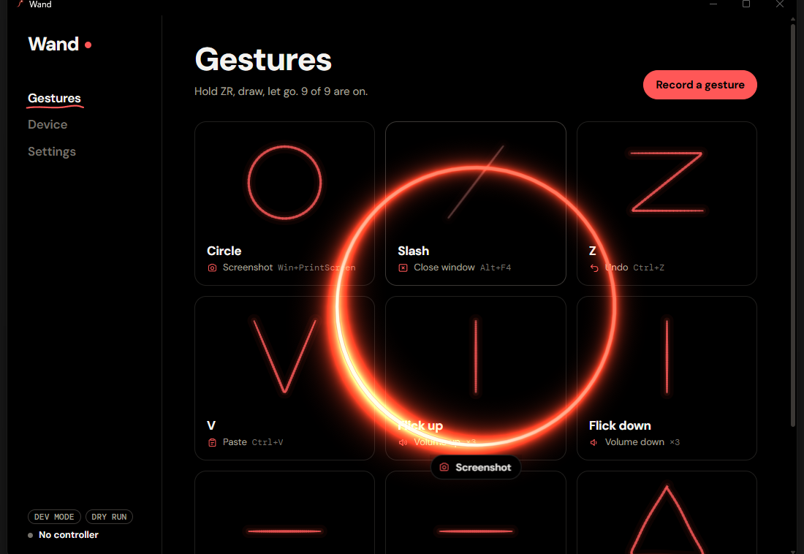

# Wand

Wand is a Windows app that turns a Nintendo Switch 2 Joy-Con into a wand. Hold ZR, draw a shape in the air, let go, and a key combination, media key, program or command runs. A transparent overlay draws the stroke as you make it and shows which gesture it was taken for.

Tauri v2. Rust does Bluetooth, sensor fusion, recognition and actions. TypeScript and WebGL2 draw the overlay and the settings window.



## Status

Tested with one right-hand Joy-Con 2 on Windows 11 and a built-in Bluetooth adapter:

- Pairing from sync mode, and reconnecting on a button press after a restart.
- Buttons, gyro, accelerometer and magnetometer arriving at about 68 reports a second.
- The overlay holding 240 fps on a 240 Hz display (median frame 4.2 ms).
- Recognition of the first eight gestures. In one session of 321 strokes, 283 of the 315 long enough to count matched. The misses include scribbles and shapes that are not in the library.

Not tested: the left Joy-Con and the Pro Controller 2, how the rumble feels, magnetometer calibration on hardware, battery percentage against the console, and "Start with Windows". The six gestures in the lower half of the table pass with generated sensor data and take nothing from 370 logged real strokes, but nobody has drawn them with a controller yet.

## Build and run

You need Rust (stable, MSVC), Node 20 or later with pnpm, and the Visual Studio C++ build tools.

```powershell
pnpm install
```

```powershell
pnpm app
```

`pnpm bundle` builds an installer into `src-tauri\target\release\bundle\nsis\`. Tests: `cargo test --manifest-path src-tauri/Cargo.toml`.

## Pairing

Joy-Con 2 use Bluetooth LE with Nintendo's own pairing, which Wand speaks itself. Do not pair the controller in Windows settings: Windows cannot do it, and the attempt makes the controller hang up. If it is listed there, remove it.

1. Open Wand and go to **Device**.
2. Hold the small round sync button on the Joy-Con's rail until the lights chase.
3. Wait a few seconds for it to connect.

After that, pressing any button reconnects it. A Joy-Con paired here stops reconnecting to the Switch until you pair it with the console again.

## Gestures

Hold ZR (ZL on a left Joy-Con), draw, release. The action runs at once; the animation follows.

| Gesture | How to draw it | Action |
| --- | --- | --- |
| Circle | either way round, from any point | Screenshot (Win+PrintScreen) |
| Slash | a diagonal, down to the left or up to the right | Close window (Alt+F4) |
| Z | as written | Undo (Ctrl+Z) |
| V | as written, or as a tick | Paste (Ctrl+V) |
| Flick up / down | a straight line | Volume up / down |
| Flick left / right | a straight line | Previous / next track |
| Chevron | `>`, top to bottom | Play / pause |
| Caret | `^`, left to right | Copy (Ctrl+C) |
| Infinity | from the crossing, either way | Switch window (Alt+Tab) |
| Star | five points in one stroke, either way round | Task view (Win+Tab) |
| M | as written | Mute |
| S | from the top right | Save (Ctrl+S) |

Wand strokes shorter than 10 degrees of travel or slower than 8 degrees a second are ignored, so pressing the trigger does not fire anything.

To add your own, press **Record a gesture**, draw the shape three times and bind it to a key combination, media key, program or command. Click any card to rebind it, turn it off or draw it again in your own hand. The library is `gestures.json` in `%APPDATA%\app.wand.desktop\`.

## Calibration

All on the Device page.

- **Recentre**: point at the middle of the main monitor and click the stick.
- **Gyro**: Wand learns the gyro offset whenever the controller lies still. The Calibrate button does the same on demand.
- **Magnetometer**: optional. Press Calibrate and turn the controller through every direction until the bar fills. It keeps the pointing centre from wandering over minutes. Strokes do not need it.
- **Sensitivity**: `pointing.px_per_degree`, 42 by default. If strokes run off the screen, lower it. 24 suited wrist-drawn strokes on a 1440p monitor.

## Configuration

Every threshold is in `%APPDATA%\app.wand.desktop\wand.toml`, with a comment on each line. Saving the file reloads it. The ones that matter most are `recognizer.min_score` (0.80), `recognizer.min_margin` (0.04), `pointing.px_per_degree`, `stroke.min_length_deg` and `stroke.min_speed_deg_s`.

## Working on it without a controller

- **Dev mode** (tray menu or Settings): hold Right Ctrl and move the mouse. The points go through the same recogniser and overlay.
- `wand.exe --dry-run` logs actions instead of running them.
- Every stroke is appended to `strokes.jsonl` in the data folder. `wandtool strokes <file>` scores a log again with the current code, which is how recogniser changes are checked against real hands. 44 such strokes are a test fixture in `src-tauri/tests/data/`.
- `wandtool selftest 200` draws every gesture with 200 generated hands and prints hit rates and margins.
- "Record controller traffic" in Settings writes raw input reports to a `.wandrec` file. `wandtool replay <file>` feeds one back through the whole pipeline.

Run the tool with `cargo run --manifest-path src-tauri/Cargo.toml --bin wandtool -- <command>`.

## How it works

- `protocol.rs`, `joycon.rs`: the Joy-Con 2 protocol over btleplug (scan, pairing, feature flags, input reports, rumble).
- `fusion.rs`: a Mahony-style filter. Gravity corrects pitch and roll, magnetic heading corrects yaw only, gyro bias is learned at rest.
- `pointing.rs`: projects where the tip points onto a plane, so wrist roll does not move the point.
- `recognizer.rs`: a $1-family template matcher. Lines keep their proportions, other shapes are stretched to a unit box so an oval is still a circle, and tails or hooks around a shape are trimmed for a second try.
- `engine.rs`, `actions.rs`: strokes in, overlay messages, key presses and rumble out.
- `src/overlay/`: one click-through, always-on-top window per monitor, drawn with WebGL2 into a half-float buffer so glow does not pile up where a stroke crosses itself. Nothing runs while idle.

On the controller tested, the timestamp in the input report does not count microseconds, so sample timing comes from when reports arrive.

## Limits

- Windows only, one controller at a time.
- The overlay sits above full-screen games too. Some systems turn off variable refresh rate under it; quit Wand from the tray if that happens.
- About 500 MB in the tray, most of it WebView2 (one web view per monitor).
- Windows blocks injected keys into windows that run as administrator.

## Sources

The Joy-Con 2 protocol comes from [ndeadly/switch2_controller_research](https://github.com/ndeadly/switch2_controller_research), [Nadeflore/switch2-controllers](https://github.com/Nadeflore/switch2-controllers) and [CareyScott/switch2controllerpc](https://github.com/CareyScott/switch2controllerpc).
